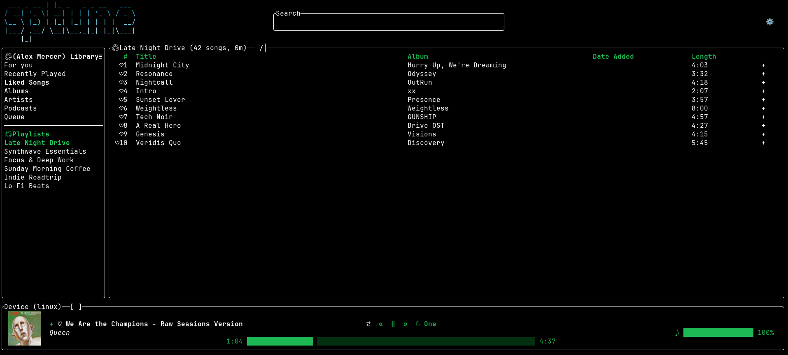
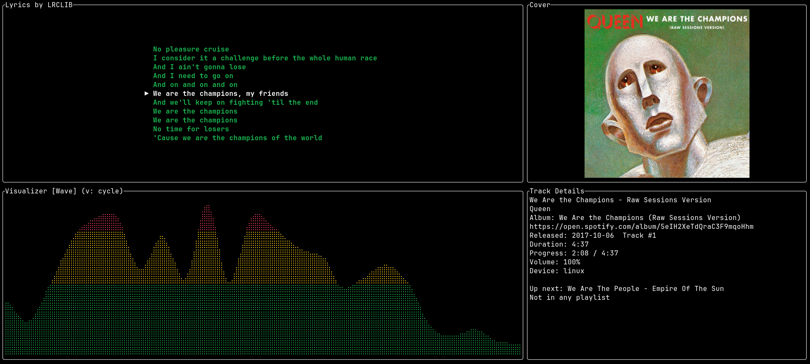
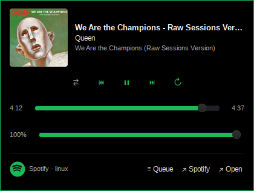

<div align="center">

<pre>
 ___ _ __ | |_ _   _ _ __   ___ 
/ __| '_ \| __| | | | '_ \ / _ \
\__ \ |_) | |_| |_| | | | |  __/
|___| .__/ \__|\__,_|_| |_|\___|
    |_|                         
</pre>

**A Spotify client for people who live in the terminal.**

Powered by Spotify (music data from the Spotify Web API; Spotify is a trademark of Spotify AB).

[](LICENSE)
[](https://www.rust-lang.org)
[](https://proxylat.github.io/sptune/)

</div>

<p align="center">
  
</p>
<p align="center">Home View</p>

<p align="center">
  
</p>
<p align="center">Music View</p>

<p align="center">
  
</p>
<p align="center">Tray Popup</p>

## Why sptune

- **Official Spotify Web API only:** `sptune` uses official Spotify Web API methods with OAuth 2.0 PKCE and never relies on `librespot` or unofficial partner APIs, keeping your account safe.
- **Request-optimized by design:** `sptune` fetches data only when needed, caches library and playlist metadata on disk for 7 days, routes interactive playback controls on a priority lane ahead of background syncs, and uses OS media events (MPRIS on Linux, GSMTC on Windows) plus Soloist local WebSockets to cut background polling.
- **Customizable "For You" view:** Press `Ctrl+V` (or click the top paste box in **For you**) to pin and open any Spotify playlist URL/URI.
- **Backup CLI (`sptune backup`):** Export all playlists and Liked Songs to CSV (and optionally JSON) with `sptune backup --dir ./sptune-backup --json`.
- **TUI and CLI:** Full mouse and vim-style keyboard navigation, synced lyrics, a draggable playbar scrubber, and a scriptable CLI for window-manager keybinds.
- **Soloist Integration:** Spotify's official headless Connect client with local audio output — `sptune` spawns and pairs it automatically, then streams playback state and sends low-latency playback commands over a local WebSocket. See the [docs](https://proxylat.github.io/sptune/#page-soloist).
- **Desktop client optimization:** Optional system-level tweaks and lean Chromium startup flags trim memory, suspend idle child processes, and disable costly background services in the official Spotify desktop app so it stays light while you game or work.

Requires a **Spotify Premium** account and an active Spotify player (Soloist on Linux, the official desktop client, [spotifyd](https://github.com/Spotifyd/spotifyd), the web player, or Spotify on another device). **Linux and Windows 10/11 only — macOS is not officially supported.**

## Install

```bash
cargo install --git https://github.com/proxylat/sptune
# or from a local clone:
cargo install --path .
```

## Docs

- [Installation & auth](https://proxylat.github.io/sptune/#install) · [Features](https://proxylat.github.io/sptune/#tui) · [Keyboard shortcuts](https://proxylat.github.io/sptune/#keyboard) · [CLI](https://proxylat.github.io/sptune/#cli) · [Configuration](https://proxylat.github.io/sptune/#configuration) · [Benchmarks](bench.md)

## Credits

Based on [spotify-tui](https://github.com/Rigellute/spotify-tui), rebuilt for `sptune` with mouse support, a draggable playbar scrubber, synced lyrics, Soloist integration, and desktop client optimization.

Thanks to [ratatui](https://github.com/ratatui/ratatui), [rspotify](https://github.com/ramsayleung/rspotify), [crossterm](https://github.com/crossterm-rs/crossterm), and [tokio](https://github.com/tokio-rs/tokio).

## License

All code unique to `sptune` is licensed under [MIT](LICENSE).
